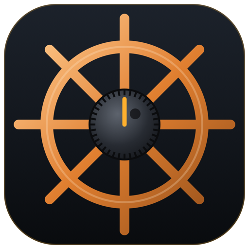

# RigHelm for Android



A native Jetpack Compose remote for [RigHelm](../righelm), the Android twin of
[RigHelm for iPhone](../righelmIOS). It never talks to a radio itself: it controls a RigHelm
instance that owns the radio (Yaesu FTDX3000), over the same LAN protocol a second desktop
copy of RigHelm uses.

- **Finds stations by itself.** RigHelm servers beacon on UDP 4534 and answer a probe. The
  app holds a Wi-Fi multicast lock so Android lets the beacons in, and also sends the probe
  straight to every address on the Wi-Fi subnet (access points often filter broadcasts).
  Stations can also be added by address.
- **Control.** Frequency (helm-wheel knob, drag on the display, ◀ ▶ steps, or type it in),
  bands, modes, VFO A/B, split, lock, ATU, antenna; receiver, filter, DSP, transmitter,
  clarifier and CW settings; S-meter, and PO/SWR/ALC while transmitting.
- **Receive audio** (24 kHz PCM over UDP) with a jitter buffer for Wi-Fi. A foreground
  service (with a notification that can disconnect) keeps the station connected and the
  audio playing with the screen off or in another app.
- **Transmit with the phone's microphone.** PHONE MIC sets the radio's AM/FM/SSB MIC SEL
  menus (053, 085, 103) to USB, like RigHelm's COMPUTER MIC switch, and puts them back
  when switched off or on disconnect. The microphone goes out only while this phone has
  keyed the radio in a phone mode, and the station must have *Accept microphone audio
  for transmit* turned on.
- **CW key.** RADIO KEY / PHONE KEY on the Operate page, like RigHelm's COMPUTER KEY. The
  phone key puts the radio in CW with break-in on and opens a `KEY` session; paddles take
  the place of push-to-talk: left half = dit, right half = dah, both = squeeze (straight
  key, iambic A or B), plus typed text, the radio's keyer speed, and an optional sidetone
  on the phone. The timing is made on the phone; the station keys its radio's port.

## Transmit safety

- **Locked by default.** *Settings → Allow transmit from this phone* must be on; it
  stays on until you turn it off.
- While locked, nothing that keys the radio leaves the phone: `TX1`, `MX1`, `AC002`
  (tune), `KY`/`EN`/`PB` playback and `VX1` are dropped in `CatClient` before they reach
  the socket (`CatCommand.isTransmit`, the same list RigHelm uses for "Block TX").
- The phone lets go when the app goes to the background, when a phone call or another
  app takes the audio, after a time-out (3 min by default), and when transmit is locked
  again. The station un-keys a client that drops off the network within 5 s.
- The CW key is never on at launch, and only arms while transmit is allowed. It goes back
  to the radio's key when the station disconnects, the radio leaves CW, transmit is
  locked, the app goes to the background, or after 10 minutes unused. A key held down
  longer than 6 s is released (by the phone and by the station), and the station lets go
  if the phone goes quiet for 1.5 s.
- A station without a password is receive-only; that is enforced by the server.

## Build

Open the folder in Android Studio and run the **app** configuration, or:

```bash
./gradlew :app:assembleDebug
```

```bash
adb install -r app/build/outputs/apk/debug/app-debug.apk
```

Application id `com.righelm.android`, Android 8.0 (API 26) or later, targets API 36.
Release builds are signed with the upload key named in `keystore.properties` (gitignored:
`storeFile`, `storePassword`, `keyAlias`, `keyPassword`; the key is `~/righelm-upload.jks`), or
with the debug key when that file is missing. For Google Play: `./gradlew :app:bundleRelease`
→ `app/build/outputs/bundle/release/app-release.aab`.
Gradle needs JDK 17 or later (Android Studio's bundled JDK works:
`export JAVA_HOME="/Applications/Android Studio.app/Contents/jbr/Contents/Home"`).

## Layout

| path | what |
|------|------|
| `core/` | Plain Kotlin (no Android): the protocol (HMAC handshake, beacons, audio packets), discovery, the CAT client and its polling, the audio link, the CW keyer and `KEY` session (a port of righelm's `cw.rs`), and the FTDX3000 state parser. A line-for-line port of the iPhone app's `RigHelmCore`, with the same unit tests. |
| `core/src/main/kotlin/com/righelm/rhcheck` | Command-line check against a real server. Read-only: transmit is locked and no Set is sent. |
| `app/…/RigController.kt` | Connection, audio, phone mic, phone CW key and transmit safety; one per process. |
| `app/…/RigService.kt` | Foreground service and notification while a station is connected. |
| `app/…/audio/AudioIO.kt` | AudioTrack playback with a playout buffer that follows the station's rate, and the CW sidetone; AudioRecord capture resampled to 20 ms frames. |
| `app/…/support/Storage.kt` | Saved stations; passwords encrypted with an Android Keystore key. |
| `app/…/ui/` | Station list, Operate (with the CW key pad), Controls, Settings. |

```bash
./gradlew :core:test
```

```bash
./gradlew :core:rhcheck --args="discover"
```

```bash
RIGHELM_PASSWORD=... ./gradlew :core:rhcheck --args="listen 192.168.10.223 10"
```

## Not in this version

The band scope and audio waterfall, memories, macros and the menu editor.
